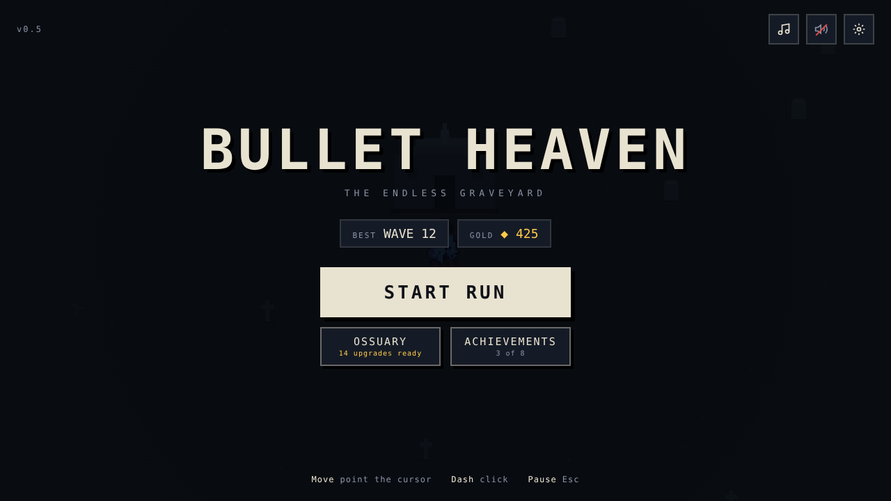
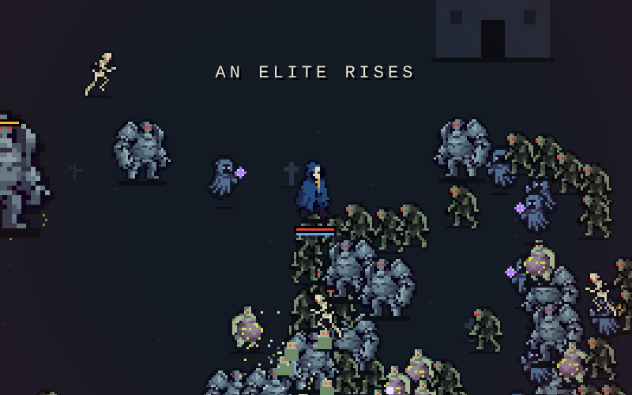

# Bullet Heaven

An endless-wave survivors-like set in a cursed graveyard. You play the Warden, holding the ossuary while the dead pour in. Your weapons fire on their own; your job is where you stand. Free to play in the browser, desktop and mobile.



## Play

Open `index.html` in any modern browser. Everything (code, sprites, music) is in that one file, so there's no build step and no install.

**Desktop:** point the cursor to move · click (or Space) to dash · Esc to pause
**Mobile:** drag anywhere to move · tap DASH

## What's in it

- **Endless waves.** Score is the highest wave you reach. 45-second waves with a short lull between them, and swarm rings and elites mixed in.
- **Four bosses, every 5 waves:** the Gravekeeper, the Weeping Widow, the Bone Hound Matriarch and the Skeleton King. Past wave 20 the Blood Moon rises and they cycle back, stronger and with new attacks.
- **Build your run:** 4 weapons, 8 passives and 4 weapon evolutions, picked from 3 cards on every level-up, elite chest and boss kill. Each boss drops a unique relic.
- **Meta-progression:** gold carries over between runs into 14 permanent upgrades, and 8 achievements unlock new weapons and passives.
- **Landscape or portrait:** the view keeps the same play area either way, and the layout switches when a phone rotates.



## Deploy (Cloudflare Pages)

1. Push this repo to GitHub.
2. In Cloudflare: **Workers & Pages → Create → Pages → Connect to Git**, then pick this repo.
3. Build settings: **Framework preset** None, **Build command** (leave empty), **Build output directory** `/`.
4. Deploy. Every push to `main` redeploys.

GitHub Pages works too: **Settings → Pages → Deploy from a branch → `main` / root**.

## Project layout

```
index.html          the whole game (HTML, CSS, JS, embedded sprites)
art/sprites/        cleaned pixel-art sprites (the copies embedded in index.html)
docs/               screenshots for this README
```

Sprites are generated with Nano Banana 2.1 via Higgsfield, then downscaled and palette-snapped to the game's pixel grid. Raw generations stay local (`art/gen/`, ignored by git).

## Saves

Gold, upgrades, achievements, best wave and settings are kept in the browser's localStorage. A run itself is never saved: dying ends it.

## Dev shortcuts

On the title screen, press `~` (or tap the version number 5 times) to show the playtest buttons. They start at a chosen wave with catch-up level-ups and earn no gold or achievements.
